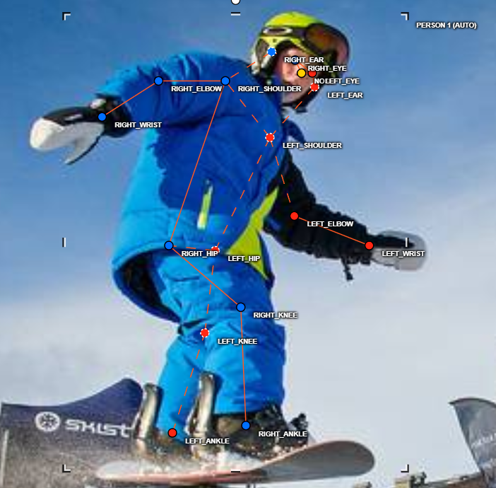
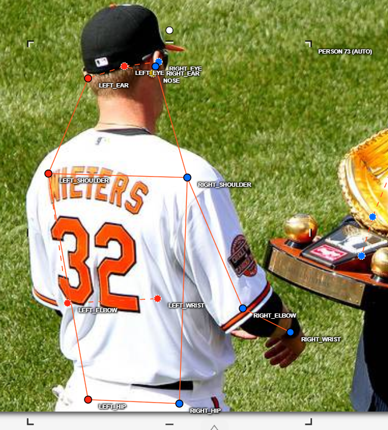
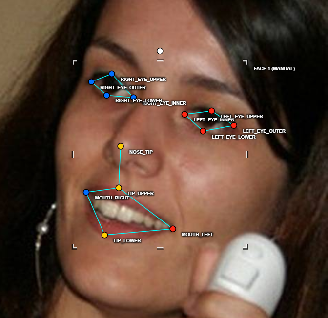
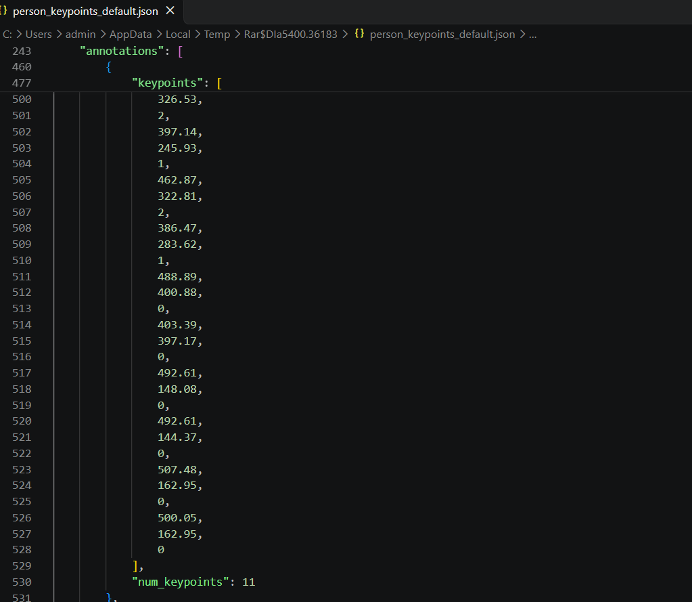

# Báo cáo cá nhân — HoVaTen-MSSV

## 0. Thông tin học viên

- Họ tên: Nguyễn Nhân Thành Long
- MSSV: 2A202603310
- Email: longnguyen5324@gmail.com
- Link repository: https://github.com/longnguyen3204/K5-L2B-DAY04-NguyenNhanThanhLong-2A202603310-KeypointPose
- Phiên bản CVAT (Help → About): 2.82.0
- Máy: hệ điều hành Windows · RAM 16 GB · chạy CVAT chế độ đầy đủ
- Bộ ảnh (`src/exports/assignment.json` do `lab.py setup` tạo): có
- Giờ bắt đầu: 16:00 - 12/11/2026
- Giờ kết thúc:

## 1. Kiểm tra label (CP0)

| Label | Kiểu | Số điểm | Tên điểm đúng bảng của lab? | Đúng thứ tự? | Số cạnh |
|---|---|---:|---|---|---:|
| `person` | Skeleton | 17 | đúng bảng 1 | có | 19 |
| `face` | Skeleton | 13 | đúng bảng 2 | có | 13 |

Mẫu `person` dựng theo người quay mặt về camera (các điểm `left_*` nằm bên phải khung mẫu)? Có

Cách đổi cờ `occluded` / `outside` cho **một điểm** trên phiên bản CVAT này (một câu): Sử dụng phím tắt Q để đổi cờ occluded, phím tắt O để outside.


## 2. Số lượng đã gán và thời gian (CP1, CP2)

| Nhóm ảnh | Số ảnh | Số skeleton đã gán | Số người dưới 60 px (không gán) | Số poster / gương / màn hình bỏ qua | Thời gian (phút) |
|---|---:|---:|---:|---:|---:|
| `easy` | 5 | 6 | 0 | 0 | 25 |
| `occluded` | 3 | 6 |  1 | 0 | 35 |
| `back` | 2 | 3 | 0 | 0 | 20 |
| `small` | 1 | 2 | 3 | 0 | 15 |
| `crowd` | 1 | 4 | 5 | 1 | 25 |
| `faces` | 8 | 8 | — | 0 | 20 |

- Số ảnh người đã xong ở mốc phút 105: 10 / 10
- Thời gian thực tế (phút): CP1 60 · CP2 60 · CP3 20
- Ảnh tốn thời gian nhất là ảnh nào, vì sao? Ảnh thuộc nhóm occluded, do phân vân giữa các khớp bị che.


## 3. Bảng ca khó (CP1, CP2)

Mỗi điểm bạn phân vân một dòng, nhất là phân vân giữa `v = 1` và `v = 0`, hoặc không chắc hướng người.

| Ảnh | Người / mặt | Điểm | Cờ đã chọn | Phân vân giữa | Lý do chọn |
|---|---|---|---:|---|---|
| 000000100510.jpg | Người | left_ankle | v=1 | v=1 và v=0 | vẫn có thể suy đoán được vị trí |

## 4. Bảng tự review (CP3)

Đi từ ảnh cuối về ảnh đầu. 5 ảnh người (ít nhất 2 ảnh `back` hoặc `crowd`) và 3 ảnh mặt. Ít nhất 8 dòng, kể cả dòng `ok`. Ghi lỗi trước, sửa sau.

Mã lỗi dùng đúng một trong: `lr_swap`, `vis_flag`, `position`, `missing`, `extra`, `ok`.

| Ảnh | Người / mặt | Điểm | Mã lỗi | Ghi chú | Đã sửa? |
|---|---|---|---|---|---|
| face_143959.jpg | mặt | 13 | ok | | |
| face_137371.jpg | mặt | 13 | ok | | |
| face_105668.jpg | mặt | 13 | ok | | |
| 000000467300.jpg | người | 28 | ok | | |
| 000000429594.jpg | người | 17 | ok | | |
| 000000272026.jpg | người | 32 | ok | | |
| 000000188804.jpg | người | 32 | ok | | |
| 000000137767.jpg | người | 32 | ok | | |

Tổng hợp số lỗi theo mã:

| `lr_swap` | `vis_flag` | `position` | `missing` | `extra` | `ok` |
|---:|---:|---:|---:|---:|---:|
| 1 | 2 | 1 | 0 | 0 | 4 |

Điểm còn phân vân giữa `v = 1` và `v = 0` (ghi cả hai lựa chọn và lý do chọn):


## 5. Kiểm file xuất và kết quả tự kiểm (CP4)

Tự kiểm tay trong file JSON:

| File | Người / mặt kiểm (ảnh, thứ tự) | Số phần tử `keypoints` | Điểm `outside` ra `v = 0`, `occluded` ra `v = 1`? | `num_keypoints` khớp? |
|---|---|---:|---|---|
| `NguyenNhanThanhLong_persons.zip` | person/1 | 17 | occluded: 5, outside: 0 | 17 |
| `NguyenNhanThanhLong_faces.zip` | face/1 | 13 | occluded: 0, outside: 0 | 13 |

Sau khi xuất, CVAT ghi `occluded` thành `v = 1` và `outside` thành `v = 0`. Tọa độ của điểm `outside` trong file vẫn mang tọa độ cũ.

Hai job đã chuyển sang completed trên CVAT? Có

Dán phần **TÓM TẮT** in ra từ `src/check_submission.py`:

```text
----- TÓM TẮT (dán vào báo cáo mục 5) -----
- File person: NguyenNhanThanhLong_persons.zip
  Số ảnh: 12 · số skeleton `person`: 21 · mỗi annotation 51 số
  Skeleton theo ảnh: 000000043968=1, 000000056651=2, 000000069971=2, 000000100510=3, 000000137767=1, 000000188804=2, 000000210604=2, 000000272026=3, 000000349521=1, 000000390585=1, 000000429594=1, 000000467300=2
  Cờ v: v=2 239 (67%) · v=1 82 (23%) · v=0 36 (10%)
  num_keypoints trung bình: 15.3
- File face: NguyenNhanThanhLong_faces.zip
  Số ảnh: 8 · số skeleton `face`: 8 · mỗi annotation 39 số
  Skeleton theo ảnh: face_105668=1, face_137371=1, face_143959=1, face_204787=1, face_257657=1, face_301643=1, face_362568=1, face_79367=1
  Cờ v: v=2 96 (92%) · v=1 8 (8%) · v=0 0 (0%)
  num_keypoints trung bình: 13.0
- Ghi chú: 36 điểm v = 0 vẫn mang tọa độ cũ (CVAT 2.x xuất như vậy; chuẩn COCO ghi 0, 0). Không phải lỗi: điểm v = 0 bị bỏ qua khi huấn luyện và khi chấm.
- Số [LỖI]: 0 · số [CẢNH BÁO]: 4
Kết quả: ĐẠT (đọc lại từng cảnh báo ở trên)
```

Các `[CẢNH BÁO]` còn giữ nguyên và lý do:

  [CẢNH BÁO] 000000043968.jpg #1: cặp knee, ankle nằm ngược phía so với các cặp còn lại. Có thể đổi trái/phải một cặp (`lr_swap`), hoặc tay / chân bắt chéo thật: kiểm lại.
  [CẢNH BÁO] 000000056651.jpg #2: cặp wrist nằm ngược phía so với các cặp còn lại. Có thể đổi trái/phải một cặp (`lr_swap`), hoặc tay / chân bắt chéo thật: kiểm lại.
  [CẢNH BÁO] 000000100510.jpg #3: `right_elbow` v = 2 nằm sát mép ảnh (1, 28). Nếu khớp thật ở ngoài ảnh, bật outside thay vì kéo về mép.
  [CẢNH BÁO] 000000188804.jpg #1: cặp ankle nằm ngược phía so với các cặp còn lại. Có thể đổi trái/phải một cặp (`lr_swap`), hoặc tay / chân bắt chéo thật: kiểm lại.

## 6. Ảnh chụp màn hình

1. Label `person` trong label constructor (đủ 17 điểm có tên):

   

2. Một người quay lưng đã gán, cờ đã đặt:

   

3. Một khuôn mặt đã gán 13 điểm, phóng to vùng mắt:

   

4. Một đoạn JSON xuất của một người:

   

Nguồn ảnh: COCO val2017.

## 7. Tự đánh giá

1. Lỗi bạn mắc nhiều nhất hôm nay, và cách bạn sẽ tránh ở dự án thật:

   ...

2. Một quy tắc bạn đề xuất thêm vào guideline (kèm ảnh ví dụ nếu có):

   ...

3. Nhãn của bạn đi vào model ở đâu? Chọn một lỗi bạn đã sửa và nói nó sẽ làm model học sai thế nào (heatmap, trọng số trong loss, hay bước lật ảnh):

   ...

## 8. Khó khăn và lỗi kỹ thuật

...

## Bonus (nếu làm)

### B1 — 3 ảnh người khó thêm

| Ảnh | Số skeleton | Số người dưới 60 px | Ca khó nhất |
|---|---:|---:|---|
| 000000104800.jpg | 3 | 0 | Người ở sát rìa ảnh bên phải |
| 000000188948.jpg | 3 | 0 | Người ở bên phải ảnh đang có hành động vung tay |
| 000000507223.jpg | 3 | 4 | |

Kết quả `src/check_submission.py` cho `NguyenNhanThanhLong_bonus_persons.zip`:

```text
=== src\exports\NguyenNhanThanhLong_bonus_persons.zip (label `person`) ===
  [CẢNH BÁO] 000000104800.jpg #1: cặp ankle nằm ngược phía so với các cặp còn lại. Có thể đổi trái/phải một cặp (`lr_swap`), hoặc tay / chân bắt chéo thật: kiểm lại.
  [CẢNH BÁO] 000000507223.jpg #3: cặp ear nằm ngược phía so với các cặp còn lại. Có thể đổi trái/phải một cặp (`lr_swap`), hoặc tay / chân bắt chéo thật: kiểm lại.
  [CẢNH BÁO] File có 3 ảnh, bài giao 12 ảnh. Xuất đúng task chưa?

----- TÓM TẮT (dán vào báo cáo mục 5) -----
- File person: NguyenNhanThanhLong_bonus_persons.zip
  Số ảnh: 3 · số skeleton `person`: 9 · mỗi annotation 51 số
  Skeleton theo ảnh: 000000104800=3, 000000188948=3, 000000507223=3
  Cờ v: v=2 81 (53%) · v=1 42 (27%) · v=0 30 (20%)
  num_keypoints trung bình: 13.7
- Ghi chú: 30 điểm v = 0 vẫn mang tọa độ cũ (CVAT 2.x xuất như vậy; chuẩn COCO ghi 0, 0). Không phải lỗi: điểm v = 0 bị bỏ qua khi huấn luyện và khi chấm.
- Số [LỖI]: 0 · số [CẢNH BÁO]: 3
Kết quả: ĐẠT (đọc lại từng cảnh báo ở trên)
```

### B2 — 5 ảnh khuôn mặt đen trắng / hồng ngoại

Ảnh không màu khó hơn ở điểm nào? 

- Mất thông tin màu sắc: Giảm từ 3 kênh RGB xuống 1 kênh độ sáng, làm giảm lượng đặc trưng đầu vào.
- Khó tách nền: Các vật thể khác màu nhưng cùng độ sáng sẽ bị hòa lẫn, khó xác định đường viền.
- Dễ nhiễu sáng: Nhạy cảm hơn với bóng đổ và lóa sáng do thiếu dữ liệu màu để bù trừ.

Kính râm trên ảnh hồng ngoại có còn là `v = 1` không?
- Về thực tế vật thể: Vẫn là v = 1.
- Về đặc trưng hình ảnh:
	• Đa số tròng kính râm thông thường cho tia cận hồng ngoại đi xuyên qua, khiến kính biến thành trong suốt và làm lộ rõ mắt.
	• Chỉ khi kính có lớp phủ chống tia IR chuyên dụng hoặc dùng camera nhiệt, kính mới giữ nguyên trạng thái tối đen/che khuất.


### B3 — Model so với nhãn của tôi (không tính điểm)

- Demo đã dùng: 
- Ảnh đã thử:

1. Model có trả điểm cho khớp bị che, hay khớp ngoài ảnh không? Confidence ở các điểm đó thế nào?

   ...

2. Với người quay lưng, model có đổi trái/phải không?

   ...

3. Bộ điểm của model có giống 17 điểm COCO không?

   ...

## 9. Tài liệu tham khảo và công cụ AI đã dùng

...
